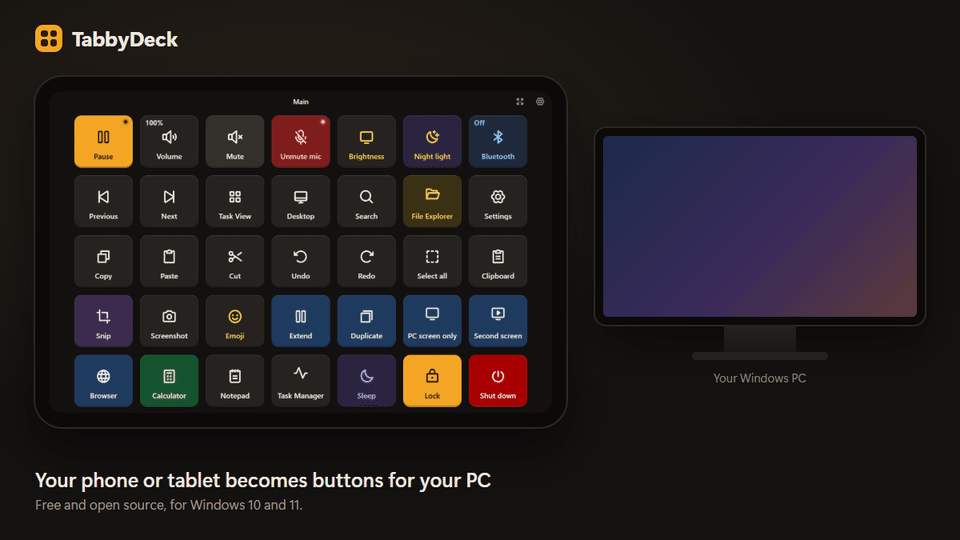
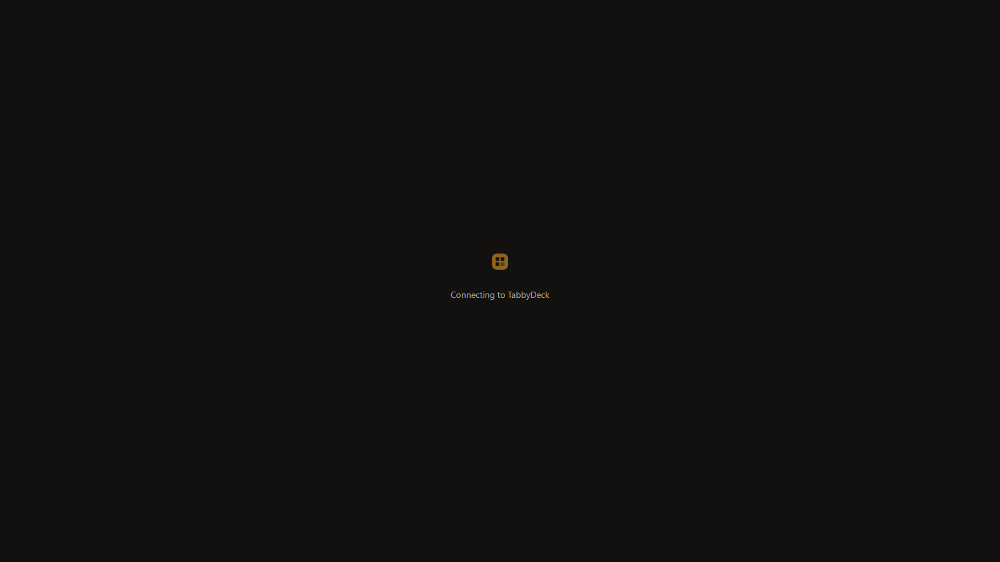
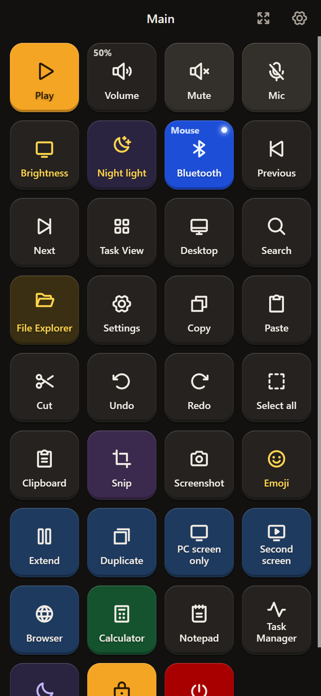
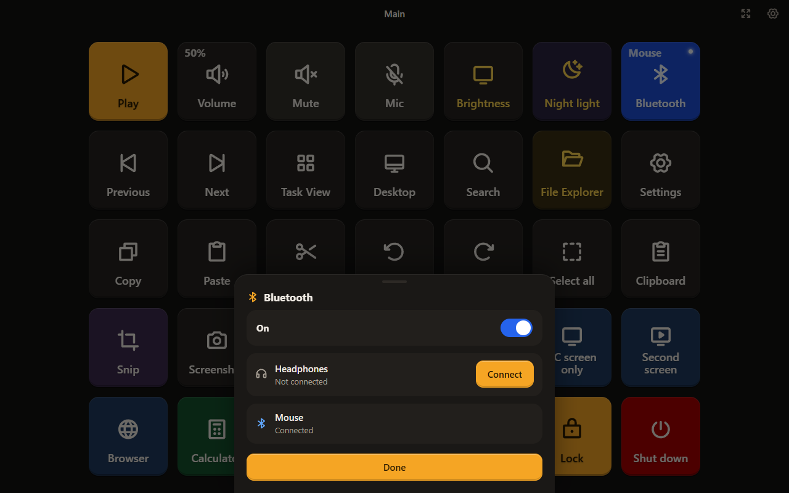

<div align="center">

# TabbyDeck

**Turn your phone or tablet into a Stream Deck for Windows. Free and open source.**

[](https://github.com/iamshihab2020/TabbyDeck/releases/latest)
[](LICENSE)




</div>

TabbyDeck puts a grid of buttons on any Android phone or tablet on your Wi-Fi. Each button does something on your PC: play or pause music, change the volume, dim a screen, open an app, press a shortcut, connect your headphones, lock or shut down. No app to install on the phone, no account, no cloud: it runs in Chrome and talks straight to your PC.

## Download and start

1. Download **TabbyDeck-0.1.0-windows-x64.zip** from the [latest release](https://github.com/iamshihab2020/TabbyDeck/releases/latest).
2. Unzip it anywhere, for example `Documents\TabbyDeck`.
3. Double-click `tabbydeck.exe`. When Windows asks whether TabbyDeck may use the network, allow **Private networks**.
4. On your phone or tablet, scan the code TabbyDeck shows, or type the address into Chrome.
5. The phone shows six digits. Type them into TabbyDeck on the PC and choose **Allow**.

Your deck appears on the phone. Windows may warn that the app is from an unknown publisher, because the exe is not signed yet: choose **More info**, then **Run anyway**.

## What it can do

- **Sound and screen:** play, pause, next and previous; a volume slider with mute; mic mute; a brightness slider for each screen, including external monitors; night light.
- **Bluetooth:** turn it on or off and connect your paired headphones or speakers from the phone.
- **Your apps:** add any installed app with its real icon, from the list of apps on your PC.
- **Shortcuts:** any key combination, typing text, mouse clicks and scrolling.
- **Windows:** Task View, desktop, search, emoji, screenshots and snips, extend or duplicate screens.
- **Power:** sleep, lock and shut down, with a confirmation first.
- **Live keys:** Mute, Mic, Night light, Bluetooth and Play / Pause show what is happening on the PC, and level keys show the percentage.

| The editor on your PC | On a phone | Bluetooth |
|---|---|---|
|  |  |  |

Build your deck in the editor on the PC: drag buttons around, resize them, pick icons and colours, make folders and profiles. The phone updates the moment you change something. Phones get thumb-sized keys that scroll; tablets show the whole deck.

## Private by design

- Only devices you approve with a code can use your deck. You can block or forget a device at any time.
- The editor only listens on your own PC.
- TabbyDeck never connects to the internet and sends no data anywhere.

## Build from source

You need Windows 10 or 11 and [Node.js 24](https://nodejs.org).

```
npm install
npm run dev        # the host with a fake native layer, plus the editor
npm test           # all tests
npm run typecheck
npm run package    # builds out/TabbyDeck/tabbydeck.exe
npm run release    # maintainer only: test, build and publish a GitHub release
```

```
apps/
  host/     the Windows app: server, store, action engine, Windows calls, tray, build
  editor/   the editor window on the PC
  deck/     the deck on the phone or tablet (under 100 KB, runs on Chrome 60)
libs/
  shared/   data model, protocol and the list of actions
  ui/       tiles, grid, icons and design tokens
```

## Contributing

Bug reports and ideas are welcome in [Issues](https://github.com/iamshihab2020/TabbyDeck/issues). Read [CONTRIBUTING.md](CONTRIBUTING.md) before you open a pull request.

## Licence

TabbyDeck is made by [Sheikh Shihab Hossain](https://github.com/iamshihab2020) and released under the [Apache License 2.0](LICENSE).

You may use, change and share it, including in your own products. If you publish TabbyDeck or a version based on it, you must keep the [NOTICE](NOTICE) file crediting the original author and say what you changed. The TabbyDeck name and logo are not part of the licence, so a modified version must use its own name.
